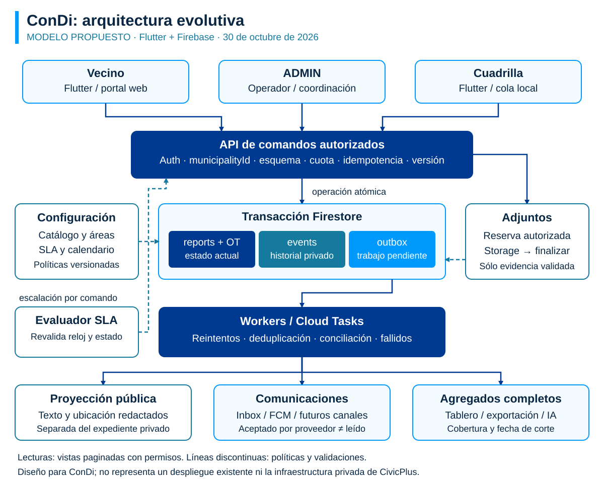

# Arquitectura propuesta para ConDi CRM municipal

Consultora Diagonales | 30 de octubre de 2026 | Diseño para discusión e implementación

## 1. Decisión de arquitectura

Evolucionar el proyecto actual mediante un backend modular en Firebase y clientes Flutter/ADMIN. Mantener reports como estado actual y añadir comandos transaccionales, eventos, catálogo municipal, SLA, órdenes de trabajo y trabajos de comunicación. La propuesta no requiere microservicios ni una migración de base de datos al inicio.

Esta es arquitectura de ConDi propuesta por la auditoría, no una reconstrucción del backend privado de CivicPlus. Se apoya en capacidades documentadas de Firebase y en la inspección local resumida en inspeccion-condi.md. No está implementada ni desplegada.

Objetivo de producto: cualquier caso aceptado debe poder responder «quién lo atiende, qué sigue, cuál es el plazo vigente y qué se comunicó». Condiciones técnicas: aislamiento municipal, reintentos recuperables, transición con versión, evidencia vinculada y métricas que no dependan de la página cargada.

## 2. Mapa de componentes



Los clientes consultan vistas paginadas autorizadas. Las acciones sensibles pasan por comandos. Dentro de una transacción se actualiza el caso y se escriben su evento y una salida pendiente. Los workers procesan comunicaciones y agregados de forma idempotente. Storage recibe archivos exclusivamente mediante reservas autorizadas.

| Componente | Responsabilidad | Reutilizar / añadir |
|---|---|---|
| App vecinal y cuadrilla Flutter | Captura, seguimiento, tarea en campo, cola local | Reutilizar pantallas/modelos; ampliar sincronización. |
| ADMIN | Triage, agenda, órdenes, comunicaciones, configuración | Modularizar app.js y conservar flujos existentes. |
| Portal público web | Autoservicio, seguimiento redactado y base de servicios | Añadir sin exponer el documento privado. |
| API de comandos | Autenticación, ámbito, validación, cuota y transición | Ampliar funciones actuales; contratos compartidos. |
| Firestore | Estado actual, políticas, eventos y outbox | Mantener colecciones actuales; ampliar con versiones. |
| Cloud Tasks / workers | Reintentos, entregas, exportaciones y escalación | Añadir progresivamente; cola durable con conciliación. |
| Storage y reservas | Adjuntos autorizados, validación y ciclo de carga | Corregir permisos sin romper alta antes del documento. |
| Proyecciones y agregados | Lectura pública redactada y KPI completos | Añadir, con reconstrucción y fecha de corte. |

Cloud Tasks admite configuración de reintentos y límites de ejecución; la idempotencia del efecto sigue siendo responsabilidad de ConDi. [F3]

## 3. Dominio y modelo de datos

### 3.1 Entidades y relaciones

Un vecino puede originar varios reportes. Un reporte representa un problema, no una jornada de cuadrilla. Un reporte puede tener varias órdenes de trabajo; cada orden puede tener tareas, asignación y evidencia propias. Un contacto de atención no necesita ser un usuario autenticado. Un duplicado mantiene su identidad original y referencia al caso canónico.

| Recurso propuesto | Campos mínimos | Invariante |
|---|---|---|
| municipalities/{id} | name, timezone, featureFlags, calendarId | Un ámbito operativo; configuración sólo por roles autorizados. |
| serviceCatalog/{id} | municipalityId, code, version, title, formSchema, ownerAreaId, routingPolicyId, slaPolicyId, visibility | Versionar políticas y validar respuestas del formulario en servidor. |
| municipalAreas/{id} | municipalityId, name, managerId, active | Área administrativa distinta del departamento geográfico. |
| reports/{id} | Campos actuales + serviceId, serviceVersion, sourceChannel, assignedAreaId, acknowledgedAt, version, visibility, duplicateOf, slaSnapshot | Campos operativos calculados/validados por servidor. |
| workOrders/{id} | municipalityId, reportId opcional, assignedTeamId, requiredForResolution, state, dueAt, version, evidenceIds | Una OT terminada no cierra automáticamente todo el caso. |
| reports/{id}/events/{id} | municipalityId, actorId, actorRole, commandId, action, at, beforeVersion, afterVersion, reason | Sólo servidor agrega; lectura privada autorizada. |
| publicReportViews/{id} | municipalityId, category, state, approximateLocation, sanitizedText, lastPublicUpdate | No contiene contacto, notas internas ni rutas privadas. |
| publicReportViews/{id}/updates/{id} | type, publicText, at, safeEvidenceIds | Timeline público separado; no se confía en ocultar campos en UI. |
| contacts/{id} | municipalityId, displayName, channels, preferences, linkedUserId opcional, retentionClass | No duplica credenciales ni cruza historias entre municipios. |
| attachmentReservations/{id} | ownerId, municipalityId, draftId/reportId, phase, storagePath, checksum, state, expiresAt | El permiso de carga está ligado a recurso, actor y fase. |
| commands/{key} | municipalityId, actorId, payloadHash, result, acceptedVersion, expiresAt | Misma clave con otro contenido se rechaza. |
| outbox/{id} | eventId, type, payloadRef, state, attempt, leaseUntil, nextAttemptAt | Evento aplicado una vez por consumidor lógico. |
| deliveryJobs/{id} | municipalityId, eventId, recipientId, channel, providerState, readAt, errorCode | No equipara proveedor aceptó con vecino leyó. |
| municipalityDaily/{id} | municipalityId, serviceId, date, created, resolved, backlog, breached, sourceVersion | Reconciliación con fuente completa; cohorte explícita. |

Usar municipalityId como nombre canónico del ámbito en las colecciones existentes. «tenant» es el concepto de aislamiento, no una orden de renombrar todos los datos. departmentId ya tiene uso geográfico en ConDi: no reciclarlo como área de mantenimiento. El catálogo no sustituye de inmediato las categorías antiguas: mapear sus códigos y conservar compatibilidad.

Los eventos son un historial append-only desde la aplicación; no son prueba criptográfica de inalterabilidad frente a administradores con privilegios de infraestructura. Si se exige conservación probatoria, diseñar exportación protegida, retención y control de acceso específico como alcance adicional.

### 3.2 Estado y transición

Conservar pending, assigned, in_progress, resolved, rejected y closed. Añadir acknowledgedAt como hito de recepción útil, sin confundirlo con iniciar trabajo. Crear un evento report_reopened que devuelve el caso a un estado activo autorizado y conserva el ciclo anterior. El diseño exacto de reapertura requiere política municipal y compatibilidad con clientes antiguos.

| Acción | Condiciones | Efecto |
|---|---|---|
| Crear | Servicio habilitado, datos válidos, cuota y municipio | pending, createdAt de servidor, política congelada. |
| Acusar / clasificar | Operador autorizado y versión vigente | Acuse, área y próxima acción; no finge resolución. |
| Asignar | Equipo activo del ámbito y estado compatible | assigned, evento y aviso. |
| Iniciar | Cuadrilla asignada y versión vigente | in_progress y hora de inicio. |
| Resolver | OT requeridas finalizadas o excepción justificada; evidencia exigida presente | resolved, fecha y resumen público redactado. |
| Cerrar | Política de validación satisfecha | closed; conserva resolvedAt. |
| Reabrir | Motivo y permiso/plazo de revisión | Nueva versión y nuevo ciclo de SLA según política. |
| Vincular duplicado | Ambos casos accesibles del mismo ámbito; sin ciclos | duplicateOf canónico y evento; no borrar el origen. |

Rechazar saltos no autorizados. Los votos de apoyo aportan señal vecinal, pero no deben desplazar criterios de riesgo material, salud o seguridad. Las emergencias necesitan derivación clara a canales oficiales definidos por cada municipio; ConDi no debe aparentar un despacho de emergencias si ese servicio no existe.

## 4. Contratos de comandos y concurrencia

Contratos propuestos: reserveAttachment, finalizeAttachment, createReport, acknowledgeReport, assignReportTeam, transitionReport, createWorkOrder, linkDuplicate, followReport, sendCaseMessage y createCampaign. Conservar nombres existentes cuando evite una ruptura; implementar nuevos comportamientos en una versión de API compatible.

```json
{
  "reportId": "synthetic-report-01",
  "expectedMunicipalityId": "municipio-piloto",
  "expectedVersion": 12,
  "idempotencyKey": "uuid-estable-del-cliente",
  "action": "assign",
  "payload": { "teamId": "equipo-01", "reason": "Cobertura de zona" }
}
```

El servidor deriva actor y rol del token/perfil y valida membresía vigente; no confía en un actorId o role del cuerpo. La clave se acota por municipio, usuario y operación. Un hash del payload detecta reutilización incorrecta. El resultado persistido permite devolver la misma aceptación si se perdió la respuesta de red.

Secuencia: autenticar y validar esquema; comenzar transacción; leer commandKey. Si existe, comprobar actor, ámbito y payloadHash y devolver el resultado persistido sin reejecutar ni exigir la versión antigua. Sólo si no existe, leer caso, permiso y equipo, comprobar expectedVersion y aplicar transición; escribir caso con version+1, evento, outbox y resultado del comando; confirmar. La retención de commandKey debe cubrir la ventana de reintentos/offline admitida; al excederla se requiere recuperación explícita, no un reenvío ciego. Las llamadas externas no se ejecutan dentro de la transacción porque ésta puede reintentarse.

Respuesta de referencia: commandId, reportId, acceptedVersion, state, eventId. Un conflicto devuelve código CONFLICT y versión vigente, con mensaje de recarga; no sobrescribe silenciosamente. Diferenciar FORBIDDEN, INVALID_ARGUMENT, RATE_LIMITED y RETRYABLE sin filtrar datos de otro ámbito.

No prometer «exactly once» de toda la infraestructura. El objetivo es efectos de negocio deduplicados frente a entrega al menos una vez. Notificaciones externas pueden duplicarse en una ventana de fallo proveedor/confirmación; usar identidad estable cuando el proveedor la soporte y registrar esa limitación.

## 5. SLA, enrutamiento y duplicados

El catálogo asigna una política por servicio, prioridad y municipio. La regla de derivación debe explicar qué coincidió: servicio, zona, horario y disponibilidad. Si no hay equipo válido, enviar a triage; no perder el caso. La primera versión puede usar reglas deterministas, sin IA como autoridad.

El SLA necesita dos relojes: respuesta y resolución. Guardar policyId/version, calendarVersion, timezone, startedAt, responseDueAt, resolutionDueAt, clockVersion y pausas con motivo. Guardar timestamps en UTC y calcular/mostrar calendario municipal; el valor inicial puede ser America/Argentina/Buenos_Aires. El municipio define horas corridas o hábiles y feriados. No copiar el calendario estadounidense del competidor.

Al cambiar plazo, responsable, pausa o estado, incrementar clockVersion. Un trabajo programado valida municipio, estado y clockVersion antes de escalar; un trabajo antiguo queda sin efecto. Usar un evaluador periódico de pendientes como recuperación y persistir atómicamente una clave por reportId, cicloSLA, tipo de reloj y nivel para deduplicar la escalación. clockVersion invalida tareas, pero un cambio de responsable no vuelve a avisar el mismo nivel del mismo ciclo. Medir tiempo pausado y exigir permiso/motivo para impedir que una pausa o cambio de prioridad maquille incumplimientos.

Para duplicados: buscar por municipio, servicio, proximidad y ventana temporal configurable; ofrecer al vecino seguir un caso. Las consultas geohash son aproximadas: filtrar distancia real y no mostrar casos privados. [F4] La fusión final es humana, mantiene referencias y evita cadenas/ciclos; los seguidores se unen sin contar dos veces al mismo usuario. Una desvinculación correctiva registra autor y motivo. No copiar un archivo irreversible si la operación necesita corrección.

## 6. Autorización, privacidad y adjuntos

La política debe cubrir documento principal, comentarios, banderas, fotos, reservas, contactos, eventos, búsqueda, exportación y funciones Admin SDK. El SDK de servidor no queda protegido por las reglas del cliente: cada comando valida autorización. En las consultas del cliente, el filtro municipal debe ser compatible con las reglas; éstas no filtran resultados prohibidos. [F1]

| Rol propuesto | Acceso |
|---|---|
| Vecino | Sus casos privados y vistas públicas permitidas; sus preferencias y suscripciones. |
| Cuadrilla | Órdenes asignadas y datos mínimos para ejecutar; evidencia de fases permitidas. |
| Operador | Atención y alta dentro de su municipio; acceso limitado a datos de contacto. |
| Coordinador | Triage, equipos, SLA y notas internas dentro de su ámbito. |
| Administración central | Ámbitos explícitamente concedidos; acciones sensibles registradas. |

Los nuevos roles deben mapearse a los existentes antes de migrar reglas. No habilitar nuevos valores de role en clientes antiguos sin analizar su comportamiento. App Check complementa autenticación y cuotas; desplegar enforcement después de verificar clientes y proveedores.

Carga propuesta: el comando reserva un draftId y una ruta; Storage valida reserva vigente y propietario/rol; el cliente carga un objeto nuevo con nombre estable; finalizeAttachment confirma tamaño, formato real y checksum; createReport o transitionReport vincula sólo adjuntos finalizados. No basta confiar en contentType enviado por el cliente. La carga de fotos actual ocurre antes de crear el reporte: una regla que simplemente exija el documento padre rompería ese flujo.

Si la foto ya se cargó y se perdió la respuesta, consultar el estado de la reserva y reutilizar el adjunto confirmado; no sobrescribir ni perder la evidencia. Limpiar reservas/objetos huérfanos mediante un job con período de gracia y reglas de retención aprobadas al implementar. La auditoría no ejecuta limpieza. Redactar metadatos y miniaturas antes de una publicación vecinal. No enviar notas internas ni contacto al índice público o base de conocimiento.

## 7. Comunicaciones y canales

Conservar FCM e inbox actuales. Un evento crea trabajos de entrega, no depende de que el coordinador mantenga abierta la pantalla. Cada canal tiene plantilla versionada y estados queued, processing, provider_accepted, failed y, sólo si existe señal, read. La bandeja permite reintentar y diagnosticar con códigos, sin almacenar contenido privado en logs.

Separar comentario interno de mensaje público en persistencia y permisos. Un mismo evento puede producir un resumen público redactado y un evento privado detallado. El usuario controla suscripciones y preferencias cuando sean comunicaciones optativas; los requisitos concretos deben definirse con la operación municipal.

Canales iniciales: app, portal y operador. Correo, SMS y WhatsApp son adaptadores posteriores con autenticación del proveedor, verificación de remitente, presupuesto, consentimiento aplicable y atención de respuestas. No se afirma que esos canales estén hoy conectados. Campañas grandes requieren audiencia congelada, paginación, progreso y cancelación controlada; una estimación de alcance no sustituye el total procesado.

## 8. Lecturas, indicadores y costos

Separar paginación de reportes de la fuente de métricas. Consultar listados con filtros en servidor y cursor estable (createdAt más identificador para desempate). Mantener listeners de páginas activas, no colecciones completas. Preparar índices por ámbito y filtros reales; no crear todas las combinaciones posibles por anticipado.

Firestore ofrece count, sum y average sobre consultas; count también respeta limit. Por ello, un count de la misma consulta limitada no arregla la cobertura. [F2] Usar agregados completos o proyecciones incrementales idempotentes por municipio/servicio/día, con reconciliación y freshnessAt. La mediana/p90 requieren una estrategia adicional, no se obtienen de un promedio.

Una reconstrucción nocturna o bajo demanda compara fuente y agregado, informa diferencias y corrige de forma versionada. Exportaciones ejecutadas en servidor conservan filtros, cutoff, cantidad total y versión de esquema; archivo privado con enlace de descarga temporal y autorización al generar. La IA recibe agregados completos o explicita muestra, truncamiento y período.

Costos a presupuestar: lecturas/escrituras Firestore, almacenamiento y egreso de fotos, tareas/funciones, envíos por canal, mapas/geocodificación y tokens de IA. Fórmula de costo por caso: costo operativo atribuible del período / casos del período con criterio de imputación explícito. Sin volúmenes ni tarifas contratadas no se asigna un precio. Medir consumo del piloto y aplicar cuotas por municipio antes de ampliar canales.

## 9. Offline, GIS y extensiones

La persistencia de un borrador y la caché de Firestore no equivalen a un flujo completo offline. Introducir una cola local durable con draftId, commandId, archivos, checksum, estado y último error. Secuencia visible: guardado local, pendiente, sincronizando, confirmado o requiere intervención. Conservar fotos hasta confirmación; reintentar con backoff y mantener identidad del comando.

La cuadrilla precarga tareas autorizadas. Si cambió la asignación o versión mientras estaba sin red, el servidor rechaza la transición conflictiva y ofrece recuperación; una foto puede conservarse como evidencia pendiente de revisión. No marcar como resuelto en otros clientes hasta confirmación de servidor. No prometer offline de CivicPlus: esa capacidad no se comprobó para SeeClickFix en esta investigación.

Conservar Georef y geohash de ConDi. Añadir polígonos municipales/zonas operativas validados en servidor antes de derivar; confirmar ambigüedades de dirección. Un conector GIS o de activos usa externalSystem, externalId, mappingVersion, syncCursor y registro de errores. Definir dueño de cada campo para evitar sobrescrituras circulares.

Una API pública futura puede adoptar un subconjunto de Open311 después de especificar contrato y permisos. Los webhooks propios de ConDi, si se habilitan, llevan firma, timestamp, identificador de evento y reintentos. Esto es una opción de diseño de ConDi; las API documentadas de SeeClickFix no usan webhooks.

## 10. Diseño de navegación y pantallas

```text
VECINO                         GESTIÓN
Inicio                         Bandeja de atención
  Servicios                      Sin acuse / Mías / Por vencer
  Reportar                       Caso + próxima acción
    Categoría                    Timeline público | interno
    Casos similares              Órdenes / evidencia
    Datos y fotos              Mapa operativo
    Confirmación               Cuadrillas y agenda
  Mis casos                    Comunicaciones
    Número y timeline          Indicadores y exportación
    Próxima acción             Configuración municipal
    Evidencia / revisión         Catálogo / SLA / equipos / roles

CUADRILLA                      OPERADOR
Mi jornada                     Buscar contacto del municipio
  Orden y ubicación              Atención telefónica / presencial
  Iniciar / pausar / finalizar    Alta asistida y canal
  Evidencia                      Caso y próxima respuesta
  Cola local / conflictos        Sin crear credenciales ficticias
```

La vista de detalle conserva identidad del caso al navegar. Los controles de acción muestran efecto y requisitos antes de confirmar. Los estados se expresan por texto e icono, además de color. Los errores conservan lo escrito y ofrecen recuperación. La prueba de accesibilidad incluye foco, teclado, lector de pantalla, zoom y tamaños de toque; un widget no sustituye esas pruebas.

## 11. Migración, calidad y puesta en marcha

Paso 1: inventariar reglas desplegadas y flujos/roles reales con datos sintéticos. Corregir autorizaciones junto con la reserva de adjuntos para evitar romper envíos. Añadir validación servidor y transacciones de asignación.

Paso 2: introducir schemaVersion/version y mapear categorías antiguas. No inventar fechas históricas de acuse: los valores desconocidos quedan nulos. Para eventos previos, crear migrated_snapshot con fecha de migración, distinguiéndolo de un evento histórico real.

Paso 3: ejecutar agregados y reglas de enrutamiento en modo sombra. Conciliar con consultas completas; el modo sombra propone sin cambiar responsables ni avisar al vecino. Habilitar catálogo, timeline y SLA por municipio mediante flags, con versión de API y compatibilidad móvil.

Paso 4: piloto con responsables de atención definidos, capacitación y criterios de salida. Incorporar OT y duplicados, luego canales y offline. Hacer backup/restauración de prueba antes de migrar datos productivos. No se verificaron backups existentes en esta auditoría.

Rollback: deshabilitar la función nueva por flag y conservar registros creados. Las reglas de seguridad corregidas no deben revertirse para mantener compatibilidad: los clientes incompatibles se actualizan o usan un camino controlado. Toda migración destructiva requiere un procedimiento revisado y copia recuperable; esta entrega no ejecuta ninguna.

Pruebas necesarias del diseño: reglas negativas entre municipios; idempotencia tras pérdida de respuesta; asignación concurrente; carga ya existente; reloj SLA con fin de semana/feriado/pausa; tarea obsoleta; duplicado sin ciclos; cierre con OT incompleta; KPI con más de 2.000 registros y caso antiguo; proyección pública sin datos privados; recuperación offline; entrega fallida y exportación autorizada.

Observabilidad: correlación commandId/eventId/jobId, latencia de comandos, conflictos, backlog de jobs, antigüedad de agregados, fallos por canal y consumo. Evitar correos, cuerpos de mensajes, coordenadas exactas y archivos en logs generales. Definir alertas y objetivos con datos del piloto, sin prometer disponibilidad contractual no medida.

## 12. Referencias y límites

F1. [Firebase: consultas y reglas](https://firebase.google.com/docs/firestore/security/rules-query). Reglas no son filtros; consulta 30/10/2026.

F2. [Firebase: agregaciones](https://firebase.google.com/docs/firestore/query-data/aggregation-queries). count, sum, average y efecto de los límites; consulta 30/10/2026.

F3. [Firebase: Cloud Tasks](https://firebase.google.com/docs/functions/task-functions). Colas, reintentos y rate limits; consulta 30/10/2026.

F4. [Firebase: consultas geográficas](https://firebase.google.com/docs/firestore/solutions/geoqueries). Geohash aproximado y falsos positivos; consulta 30/10/2026.

Evidencia de código: inspeccion-condi.md. Referencia funcional: fuentes-civicplus.md y auditoria.md. Los campos, rutas y comandos nuevos son propuestas; requieren revisión contra índices, reglas y contratos actuales. No se verificaron IAM, datos de producción, licencias de terceros, rendimiento o restauración del sistema real.
